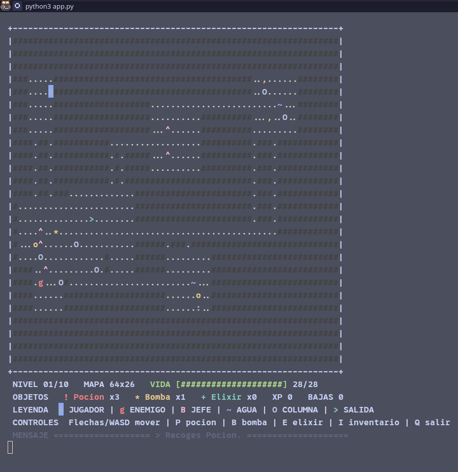

# 🕯️ Ashen Crypt


**Ashen Crypt** es un roguelike ASCII por turnos para la terminal, disponible en español e inglés.

> Explora una cripta procedural, derrota enemigos, consigue objetos y sobrevive diez niveles en una aventura de terminal sin dependencias externas.

## 🎮 Vista previa



## ✨ Características

- **10 niveles procedurales** que crecen desde `64x26` hasta `208x26`
- **Jefes en los niveles 5 y 10**, con barra de vida
- Enemigos cada vez más peligrosos, con límite para mantener la partida manejable
- **3 objetos**: poción, bomba y elixir de vigor
- Colores ANSI: jugador, agua, columnas, escombros, musgo y cristales
- HUD siempre visible: nivel, tamaño del mapa, vida, objetos, experiencia, bajas, leyenda y controles
- **Español e inglés**, sin instalar paquetes: solo Python 3
- **Semillas** para repetir un mapa concreto

## 🚀 Instalación

No necesita paquetes externos, solo [Python 3](https://www.python.org/downloads/).

### Linux y macOS

```bash
git clone https://github.com/WLDluv-stack/ash-crypt-roguelike.git
cd ash-crypt-roguelike
python3 app.py
```

También puedes descargar el proyecto como ZIP desde **Code > Download ZIP** y ejecutar `python3 app.py` dentro de la carpeta.

### Windows

Instala [Python 3 para Windows](https://www.python.org/downloads/windows/) y activa **Add Python to PATH** durante la instalación. En PowerShell o CMD ejecuta:

```powershell
git clone https://github.com/WLDluv-stack/ash-crypt-roguelike.git
cd ash-crypt-roguelike
python app.py
```

También puedes hacer doble clic en `run_game.bat`. El juego usa la consola de Windows, acepta las flechas directamente y no requiere instalar paquetes.

## 🕹️ Cómo jugar

```bash
python3 app.py
```

Al iniciar aparece una pantalla de bienvenida. Pulsa `S` para jugar en español o `E` para jugar en inglés; después pulsa `Enter` para comenzar. El idioma elegido traduce el título, el HUD, la leyenda, los controles y las pantallas de transición.

| Tecla | Acción |
| ----- | ------ |
| Flechas o `W` `A` `S` `D` | Moverse y atacar |
| `P` | Usar una poción |
| `B` | Lanzar una bomba |
| `E` | Usar un elixir |
| `I` | Mostrar el inventario |
| `Q` | Salir |

Las teclas se leen al instante, sin pulsar `Enter`. Al derrotar al último enemigo del nivel aparece una pantalla de nivel completado: pulsa `Enter` para confirmar y descender al siguiente nivel.

### Objetos

| Símbolo | Objeto | Efecto |
| ------- | ------ | ------ |
| `!` | Poción | Recupera vida al pulsar `P` |
| `*` | Bomba | Hiere a todos los enemigos cercanos al pulsar `B` |
| `+` | Elixir de vigor | Cura 14 puntos, añade +4 de daño por golpe y reduce a la mitad el daño recibido durante 8 turnos al pulsar `E` |

Los objetos se recogen caminando sobre ellos. El inventario aparece bajo el mapa y se puede consultar con `I`. El estado activo del elixir y sus turnos restantes también aparecen en el panel.

### Leyenda

| Símbolo | Significado |
| ------- | ----------- |
| `@` | Jugador, con fondo azul brillante |
| `g`, `o`, `v`, `c` | Enemigos |
| `B` | Jefe |
| `~` | Agua, bloquea el paso |
| `O` | Columna, bloquea el paso |
| `,`, `:` | Escombros y restos decorativos |
| `;` | Musgo |
| `^` | Cristal |
| `>` | Salida visual del mapa |

Las paredes, el agua y las columnas también afectan al movimiento de los enemigos, pero los corredores principales siempre quedan abiertos para que ningún obstáculo bloquee el avance.

## 🌱 Semillas

Para repetir un mapa concreto:

```bash
python3 app.py --seed 7
```

## ✅ Requisitos

- Python 3 (sin paquetes externos)
- Una terminal con soporte de colores ANSI para ver el juego a color
